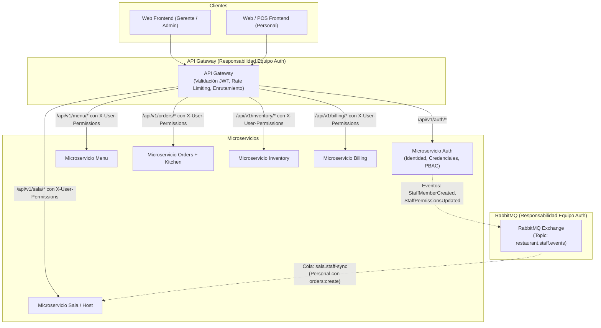

# Plan de Especificación Formal ERS — Microservicio de Auth
## Modelo de Roles como Etiquetas Dinámicas y Permisos Granulares (PBAC)

Este documento establece la estrategia y propuesta técnica para la definición y formalización del microservicio **Auth** (Autenticación, Autorización y Gestión de Personal) del ecosistema **FMAT-Restaurant**, siguiendo las normas metodológicas de la asignatura *Verificación y Validación* de la Facultad de Matemáticas (UADY).

Adicionalmente, se contemplan las responsabilidades cruzadas asignadas al equipo: el **API Gateway** (validación perimetral de credenciales y propagación de permisos granulares) y la **Cola de Eventos / RabbitMQ** (emisión de eventos de dominio como `StaffMemberCreated` y `StaffPermissionsUpdated` para alimentar a microservicios como Sala/Host e Inventario).

---

## Decisiones de Diseño Consolidadas

### 1. Modelo de Identidad y Cuentas
- **Gerente / Administrador (`RestaurantOwner` / `Admin`)**:
  - Se registra mediante Email + Contraseña + Datos de Restaurante (`restaurantName`, `address`, etc.).
  - Genera automáticamente un Tenant (`Restaurant`) y un usuario raíz con tipo `ADMIN` y permisos universales (`*`).
  - Las facultades de administración raíz no son asignables a miembros del personal operativo ordinario.
- **Personal (`StaffMember`)**:
  - Creado exclusivamente por el Gerente/Administrador de su restaurante.
  - Se le asigna un identificador único con máscara `XYYYYYY` (ej. `E000001`).
  - Se genera una contraseña temporal con estado `passwordStatus = TEMPORARY` (o `mustChangePassword = true`).
  - Al iniciar sesión con credenciales temporales, el sistema devuelve un token contenido por el API Gateway, requiriendo llamar a `POST /auth/change-initial-password` antes de poder consumir endpoints operacionales.
  - Al cambiar la contraseña, el identificador `XYYYYYY` se preserva intacto y `passwordStatus` pasa a `ACTIVE`.

### 2. Estructura del Identificador de Personal (`XYYYYYY`)
Se adopta la convención formalizada `^[A-Z][0-9]{6}$`:
- **Prefijo Canónico de Empleado:** `X = 'E'` para todo el personal operativo (ej. `E000001`, `E000002`...), garantizando neutralidad ante cualquier cambio de rol o funciones asignadas.

### 3. Roles como Etiquetas Dinámicas y Permisos Granulares (PBAC)
- **Roles:** Son simples etiquetas organizacionales descriptivas creadas libremente por el Administrador desde el panel de control (ej. *"Líder de inventario"*, *"Mesero de terraza"*, *"Capitán de sala"*). No están precodificadas ni fijas en el código.
- **Permisos:** Privilegios atómicos otorgados individualmente por el Administrador a cada empleado:

| Módulo / Microservicio | Ejemplos de Permisos Granulares |
| :--- | :--- |
| **Inventario (`inventory`)** | `inventory:view`, `inventory:ingredients:create`, `inventory:ingredients:update`, `inventory:ingredients:delete`, `inventory:stock:update_status`, `inventory:stock:adjust` |
| **Menú (`menu`)** | `menu:view`, `menu:dishes:manage`, `menu:dishes:toggle_availability` |
| **Órdenes (`orders`)** | `orders:view`, `orders:create`, `orders:update`, `orders:cancel` |
| **Cocina (`kitchen`)** | `kitchen:kds:view`, `kitchen:order:start_preparation`, `kitchen:order:mark_ready` |
| **Sala (`sala`)** | `sala:tables:view`, `sala:tables:assign_diner`, `sala:tables:assign_waiter` |
| **Caja / Cobro (`billing`)** | `billing:account:request`, `billing:payment:process` |

---

## Integraciones y Puntos Clave

> [!IMPORTANT]
> **Integración entre Auth, Sala y Host:**
> En lugar de filtrar por un enum estático `MESERO`, el microservicio **Sala/Host** consume el evento RabbitMQ `StaffMemberCreated` / `StaffPermissionsUpdated` y proyecta a los empleados que posean el permiso `orders:create` (o facultad de atención de comensales).

> [!WARNING]
> **Mecanismo de Forzado de Cambio de Contraseña:**
> Cuando un miembro con contraseña temporal ingresa al dashboard, el API Gateway deniega el acceso a cualquier microservicio operativo (`403 Forbidden: PASSWORD_CHANGE_REQUIRED`) hasta que complete exitosamente el cambio a su contraseña personal definitiva.

---

## Verificación Formal V&V
- Toda la documentación sigue el estándar de la materia de *Verificación y Validación* (UADY), clasificando los requisitos funcionales bajo los cuatro métodos: **Inspección**, **Demostración**, **Prueba** y **Análisis**.
- La arquitectura opera como una instancia local *single-tenant* estilo Soft Restaurant con soporte híbrido de roles dinámicos y permisos granulares (PBAC).

