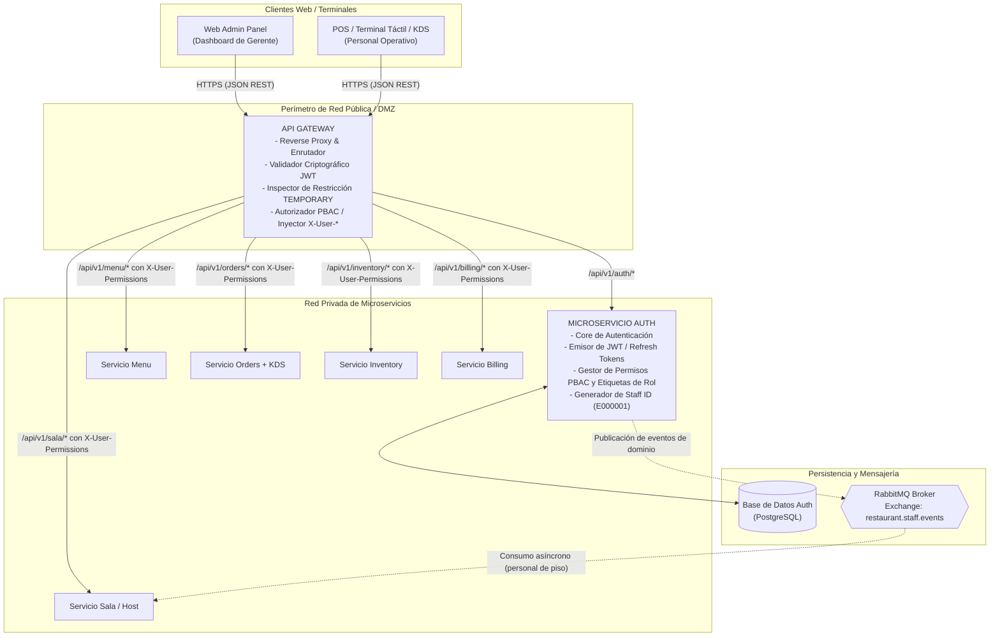
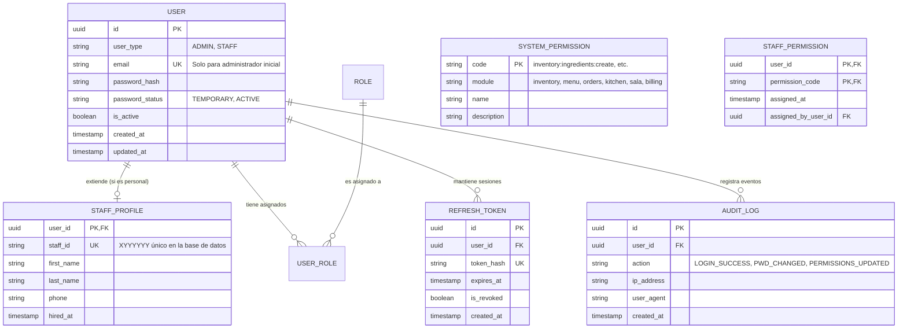
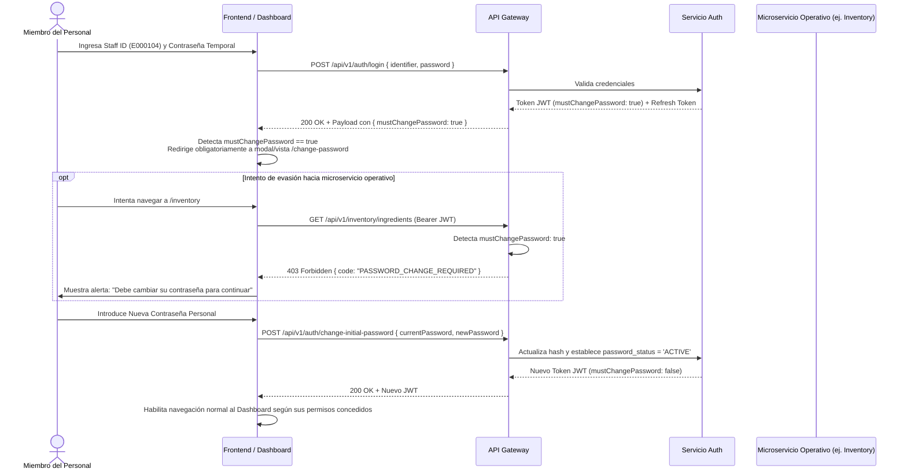

# Arquitectura del Sistema, Componentes y Flujos Técnicos

## Diagrama de Contenedores y Flujo Perimetral

La solución articula tres elementos técnicos bajo la responsabilidad directa del equipo de **Auth**: el servicio de **Autenticación y Autorización (Auth MS)**, el **API Gateway** y el broker de mensajería **RabbitMQ**.



---

## El Rol del API Gateway en la Autorización Perimetral

El **API Gateway** actúa como el guardián perimetral del sistema. Ningún microservicio interno (Menu, Orders, Sala, Inventory, Billing) expone sus puertos directamente al internet público.

### Responsabilidades Perimetrales del Gateway:
1. **Validación Criptográfica de JWT:** Verifica la firma digital del token (`RS256` o `HS256`), la expiración temporal (`exp`) y el emisor (`iss`).
2. **Evaluación de Contraseña Temporal (`passwordStatus == TEMPORARY`):**
   - Si un usuario presenta un token con `mustChangePassword: true`, el API Gateway **rechaza** cualquier petición dirigida a microservicios operativos (`/api/v1/orders/*`, `/api/v1/inventory/*`, etc.) con un código HTTP `403 Forbidden` y el error estructurado `PASSWORD_CHANGE_REQUIRED`.
   - Únicamente permite peticiones dirigidas a:
     - `POST /api/v1/auth/change-initial-password`
     - `POST /api/v1/auth/logout`
     - `GET /api/v1/auth/me`
3. **Control de Acceso Basado en Permisos (PBAC):**
   - El Gateway puede validar a nivel perimetral que el token cuente con el permiso requerido para la ruta (o delegar la verificación fina al microservicio downstream mediante cabeceras).
4. **Propagación Segura de Identidad y Permisos (Header Sanitization):**
   El API Gateway elimina cualquier cabecera `X-User-*` proveniente del cliente exterior para prevenir inyección de identidad (*Header Spoofing*), y tras validar el JWT, inyecta cabeceras confiables hacia la red interna:
   - `X-User-Id`: UUID único del usuario.
   - `X-Staff-Id`: Identificador `XYYYYYY` (ej. `M000104`, o `ADMIN` para gerentes).
   - `X-User-Roles`: Lista separada por comas (`HOST,MESERO,ROL_SUBADMIN`).
   - `X-User-Permissions`: Lista de permisos granulares separada por comas (`inventory:view,inventory:ingredients:create`).

---

## Especificación del Token de Acceso (JWT)

El token de acceso emitido por el servicio Auth es un JSON Web Token estándar (RFC 7519) firmado con algoritmo simétrico `HS256`.

### Formato de Cabecera (Header)
```json
{
  "alg": "HS256",
  "typ": "JWT"
}
```

### Formato de Carga Útil (Payload / Claims)
```json
{
  "iss": "urn:fmat:restaurant:auth",
  "sub": "usr_9b1deb4d-3b7d-4bad-9bdd-2b0d7b3dcb6d",
  "aud": "urn:fmat:restaurant:api",
  "iat": 1790294400,
  "exp": 1790298000,
  "staffId": "M000104",
  "email": null,
  "roles": [
    "MESERO"
  ],
  "permissions": [
    "orders:view",
    "orders:create",
    "menu:view",
    "sala:tables:view"
  ],
  "mustChangePassword": false
}
```

### Definición de Claims:
- `sub`: Identificador universal único del usuario (UUID v4).
- `staffId`: Identificador estructurado `XYYYYYY`. Para el Administrador/Gerente toma el valor literal `ADM000001` o `ADMIN`.
- `roles`: Arreglo de cadenas con los códigos de roles asignados (`ADMINISTRADOR`, `HOST`, `ALMACENISTA`, `MESERO`, `CHEF_MASTER` o roles personalizados `ROL_*`).
- `permissions`: Arreglo de strings con los códigos canónicos de permisos asignados al usuario (`<modulo>:<recurso>:<accion>`). Para el Gerente/Administrador contiene `["*"]`.
- `mustChangePassword`: Booleano que indica si el usuario debe actualizar obligatoriamente su clave temporal antes de operar.

---

## Modelo Entidad-Relación y Persistencia

El modelo de datos relacional de Auth soporta roles del sistema y roles personalizados con permisos granulares por microservicio:



---

## Flujo de Primer Ingreso y Forzado de Contraseña

Este diagrama de secuencia ilustra el flujo de control cuando un miembro del personal ingresa con su clave temporal:



---

## Integración con RabbitMQ (Eventos de Personal)

El servicio Auth actúa como productor de eventos para notificar al clúster de cambios relevantes en el personal y sus facultades operacionales.

### Topología de Mensajería:
- **Exchange:** `restaurant.staff.events` (Tipo `topic`, durable).
- **Routing Keys:**
  - `staff.created`: Emitido cuando el gerente da de alta un nuevo empleado con su etiqueta y permisos.
  - `staff.permissions.updated`: Emitido al modificar la etiqueta de rol o la matriz de permisos de un empleado.
  - `staff.status.changed`: Emitido al activar o desactivar un perfil de personal.

### Ejemplo de Evento: `StaffMemberCreated`
```json
{
  "specversion": "1.0",
  "type": "urn:fmat:event:staff:member-created",
  "source": "urn:fmat:service:auth",
  "id": "evt_7f1c4e92-31d8-4fbb-b2d9-11c2a048a120",
  "time": "2026-09-25T00:30:00Z",
  "datacontenttype": "application/json",
  "data": {
    "userId": "usr_9b1deb4d-3b7d-4bad-9bdd-2b0d7b3dcb6d",
    "staffId": "E000104",
    "firstName": "Juan",
    "lastName": "Pérez",
    "roleLabel": "Líder de inventario",
    "permissions": [
      "inventory:view",
      "inventory:ingredients:create",
      "inventory:ingredients:update",
      "inventory:ingredients:delete",
      "inventory:stock:update_status",
      "inventory:stock:adjust"
    ],
    "isActive": true
  }
}
```

### Consumo en Microservicio `Sala`:
- El servicio Sala mantiene una cola enlazada a `staff.*`. Al recibir eventos de personal, evalúa la presencia del permiso `orders:create` (o permisos de atención de comensales). Si el empleado cuenta con dicha capacidad, Sala lo incluye en la tabla de personal disponible para atender mesas, desacoplando completamente la lógica interna de nombres y títulos de puesto.
