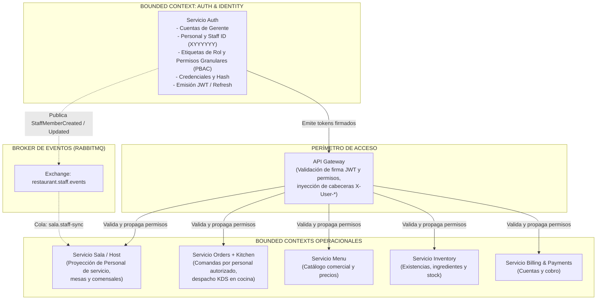
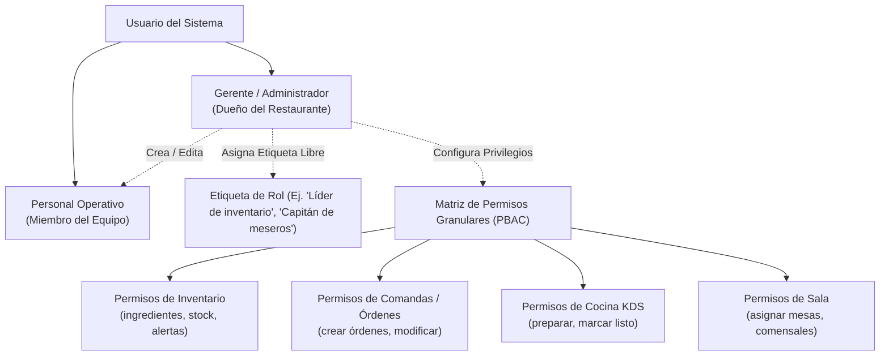

# Contexto, Alcance y Lenguaje del Dominio (Auth)

## Responsabilidades del Bounded Context Auth

El servicio **Auth** es la autoridad exclusiva sobre la **identidad, autenticación, autorización y administración de personal** del ecosistema distribuido FMAT Restaurant. Sus responsabilidades se concentran en dar respuesta certera y verificable a cuatro preguntas fundamentales del sistema:

1. **¿Quién es el actor que intenta acceder al sistema?** (Autenticación e identificación unívoca).
2. **¿A qué restaurante o tenant pertenece su cuenta?** (Aislamiento de dominio multi-restaurante).
3. **¿Qué funciones, vistas y microservicios está autorizado a operar?** (Control de acceso basado en permisos granulares — PBAC y claims de autorización).
4. **¿Cuál es el estado operativo de sus credenciales de acceso?** (Vigencia de contraseña, forzado de actualización de contraseña temporal, sesiones activas).

En consecuencia, las responsabilidades de Auth abarcan:

- **Custodia de credenciales y seguridad:** Almacenamiento seguro, salado y dispersión (hashing) de contraseñas de gerentes y personal operativo mediante funciones de derivación criptográfica de alta resistencia (Argon2id o bcrypt).
- **Aislamiento Multi-Tenant:** Custodiar la pertenencia estricta de cuentas y personal a su respectivo `Restaurant`, asegurando que ningún usuario pueda visualizar ni interactuar con datos ajenos a su tenant.
- **Gestión del ciclo de vida del personal:** Registro, habilitación, deshabilitación y actualización de perfiles de miembros de equipo por parte del Gerente/Administrador del restaurante.
- **Emisión de identificadores estructurados:** Asignación automática e inmutable del identificador de personal con máscara `XYYYYYY` con prefijo canónico `E` (ejemplo: `E000001` a `E999999`).
- **Gestión de contraseñas temporales y forzado de primer ingreso:** Proveer contraseñas de primer uso configurables por el administrador y forzar la transición a contraseña personal en el primer inicio de sesión mediante contención operativa perimetral.
- **Autorización basada en permisos granulares (PBAC) y etiquetas de rol:** Custodia del catálogo transversal de permisos operacionales (`inventory:*`, `orders:*`, `menu:*`, `kitchen:*`, `sala:*`, `billing:*`) y asignación personalizada de permisos a cada empleado, acompañada de una etiqueta descriptiva organizacional (ej. *"Líder de inventario"*, *"Capitán de meseros"*).
- **Emisión e invalidación de tokens de acceso:** Generación de JSON Web Tokens (JWT) firmados digitalmente que portan la identidad, el tenant, la etiqueta de rol, el conjunto de permisos granulares vigentes y el estado de cambio de contraseña, permitiendo la validación descentralizada en el API Gateway y microservicios internos.
- **Publicación de eventos operacionales de personal:** Difusión asíncrona mediante RabbitMQ de eventos de dominio (`StaffMemberCreated`, `StaffPermissionsUpdated`, `StaffStatusChanged`) para la alimentación de proyecciones dependientes en microservicios consumidores (como la identificación de personal con facultades de mesero para asignación de mesas en `Sala/Host`).

---

## Límites de Contexto y Ownership de Datos

La arquitectura global del sistema sitúa a Auth como el proveedor de confianza para la identidad de todos los clientes y microservicios:

### Principios Fundamentales de Aislamiento y Ownership

1. **Auth es la autoridad exclusiva sobre identidades, etiquetas y permisos:** Ningún otro microservicio (Menu, Orders, Inventory, Sala, Billing) almacena contraseñas, valida credenciales de login ni altera la asignación de permisos de un empleado.
2. **Desacoplamiento de nombres y datos operativos:** Microservicios como `Orders` o `Sala` registran el `staffId` (`XYYYYYY`) como una referencia opaca en sus registros (ejemplo: `waiterId: "E000102"` en una comanda, o `hostId: "E000045"` al asignar una mesa).
3. **Proyección de Personal de Servicio en Sala:** El microservicio `Sala` requiere conocer la lista de empleados facultados para atender comensales. Esta necesidad se satisface mediante **proyecciones eventuales** alimentadas por eventos emitidos por Auth (`StaffMemberCreated`, `StaffPermissionsUpdated`), filtrando a los empleados que posean el permiso `orders:create` (o asignados a servicio de sala), sin llamadas HTTP síncronas bloqueantes entre Sala y Auth.
4. **Verificación Perimetral en API Gateway:** Los microservicios internos no repiten la autenticación criptográfica pesada en cada endpoint; el API Gateway verifica el token JWT emitido por Auth y despacha a la red interna cabeceras de contexto sanitizadas:
   - `X-User-Id`: Identificador único de usuario (UUID).
   - `X-Staff-Id`: Identificador estructurado `XYYYYYY` (o `ADMIN` para gerentes).
   - `X-Restaurant-Id`: Identificador del restaurante (tenant).
   - `X-User-Role-Label`: Etiqueta descriptiva del rol del empleado (ej. `Líder de inventario`).
   - `X-User-Permissions`: Lista separada por comas de permisos vigentes (`inventory:view,inventory:ingredients:create,...`).
   - `X-Password-Temporary`: Indicador booleano de contraseña provisional.

---

## Taxonomía de Actores y Modelo de Autorización

### 1. Gerente / Administrador (`ADMINISTRADOR`)
- **Naturaleza:** Cuenta raíz del restaurante creada mediante proceso de auto-registro (Sign-up) con correo electrónico comercial.
- **Exclusividad y Alcance:** El Administrador es la máxima autoridad del tenant. Ostenta permisos globales de superusuario (`*`) sobre todos los módulos de su restaurante y es el único habilitado para administrar la nómina operativa y configurar permisos del personal.
- **Capacidades:**
  - Acceso total e irrestricto a todas las vistas, métricas y microservicios del sistema.
  - Creación y desactivación de perfiles de personal.
  - Definición libre de etiquetas de rol (ej. "Líder de inventario", "Mesero terraza", "Subchef").
  - Configuración granular de los permisos que cada empleado puede ejercer.
  - Suministro y reseteo de contraseñas temporales para su equipo.

### 2. Personal Operativo (`StaffMember`) y Ejemplos de Perfiles por Permisos

A diferencia de un esquema con roles fijos precodificados en código o base de datos, los roles son **etiquetas descriptivas** para facilitar la organización humana en el restaurante. Los accesos efectivos a vistas y acciones se derivan estrictamente de los **permisos granulares** otorgados:

- **Ejemplo 1 — Líder de Inventario (Almacén Avanzado):**
  - *Etiqueta asignada por el admin:* `"Líder de inventario"`
  - *Permisos concedidos:* `inventory:view`, `inventory:ingredients:create`, `inventory:ingredients:update`, `inventory:ingredients:delete`, `inventory:stock:update_status` (marcar ingredientes como *"Pocas unidades restantes"* o *"Sin unidades restantes"*), `inventory:stock:adjust`.
  - *Comportamiento:* El Dashboard habilita la navegación al módulo de Inventario y renderiza los controles para agregar, eliminar ingredientes y cambiar los estados de disponibilidad de insumos.
- **Ejemplo 2 — Mesero / Personal de Servicio:**
  - *Etiqueta asignada por el admin:* `"Mesero de piso"` o `"Capitán de meseros"`
  - *Permisos concedidos:* `orders:create`, `orders:view`, `menu:view`, `sala:tables:view`, `billing:account:request`.
  - *Comportamiento:* Habilita la interfaz POS móvil de comandas, catálogo de menú y consulta de mesas.
- **Ejemplo 3 — Host / Recepción de Sala:**
  - *Etiqueta asignada por el admin:* `"Hostess"` o `"Recepción"`
  - *Permisos concedidos:* `sala:tables:view`, `sala:tables:assign_diner`, `sala:tables:assign_waiter`.
  - *Comportamiento:* Acceso al mapa de mesas interactivo y cola de asignación de comensales.
- **Ejemplo 4 — Chef Master / Línea de Cocina:**
  - *Etiqueta asignada por el admin:* `"Chef Master"` o `"Líder de cocina"`
  - *Permisos concedidos:* `kitchen:kds:view`, `kitchen:order:start_preparation`, `kitchen:order:mark_ready`, `inventory:view`.
  - *Comportamiento:* Visualización de la pantalla KDS de comandas entrantes y despacho culinario.
- **Ejemplo 5 — Empleado Polivalente (Multi-Área):**
  - *Etiqueta asignada por el admin:* `"Coordinador de turno"`
  - *Permisos concedidos:* Combinación de permisos de sala, comandas e inventario según determine el administrador.

---

## Lenguaje Ubicuo del Dominio (Glossary)

- **Tenant / Restaurant:** Entidad comercial que agrupa una operación gastronómica independiente con su propio catálogo, inventario, mesas y personal.
- **Gerente (Restaurant Owner):** Usuario titular del tenant con cuenta de administración, facultado para registrar personal y gobernar la política de permisos de su restaurante.
- **Staff Member (Personal):** Empleado dado de alta en un restaurante para desempeñar tareas operativas. Posee un `staffId` inmutable, una etiqueta de rol descriptiva y un conjunto explícito de permisos concedidos.
- **Staff ID (`XYYYYYY`):** Código alfanumérico único por restaurante asignado al personal. Sigue la convención `E` seguida de 6 dígitos numéricos secuenciales (ej. `E000001` a `E999999`).
- **Etiqueta de Rol (Role Label / Tag):** Denominación organizacional o título de puesto libre asignado por el Gerente para identificar a un miembro del personal (ej. *"Líder de inventario"*, *"Capitán de meseros"*). No está precodificada en el sistema ni limita por sí misma los accesos técnicos.
- **Permiso Granular (Granular Permission):** Privilegio atómico y explícito que habilita una acción o vista específica dentro de un microservicio del sistema (ej. `inventory:ingredients:create`, `inventory:stock:update_status`). Sigue el formato canónico `<servicio>:<recurso>:<accion>`.
- **Permission-Based Access Control (PBAC):** Modelo de autorización donde los privilegios efectivos de navegación y ejecución de APIs se evalúan a partir del conjunto de permisos explícitos otorgados a la cuenta.
- **Contraseña Temporal (Temporary Password):** Clave inicial provista por el administrador o autogenerada con estado `passwordStatus = TEMPORARY`. Habilita únicamente la sesión restringida de primer ingreso para su reemplazo mandatorio.
- **Contraseña Personal (Personal Password):** Clave definitiva seleccionada de forma privada por el miembro del personal, que promueve su estado a `passwordStatus = ACTIVE`.
- **Access Token (JWT):** Token criptográfico de corta duración firmado digitalmente, portador de las claims de identidad, tenant, etiqueta de rol y lista de permisos concedidos.
- **Refresh Token:** Credencial de larga duración almacenada de forma segura para renovar Access Tokens sin requerir reingreso de credenciales.
- **Contención Perimetral:** Mecanismo en el API Gateway y en el Dashboard que bloquea la navegación a microservicios si el token indica `mustChangePassword = true`, forzando la visualización exclusiva del formulario de cambio de clave.
